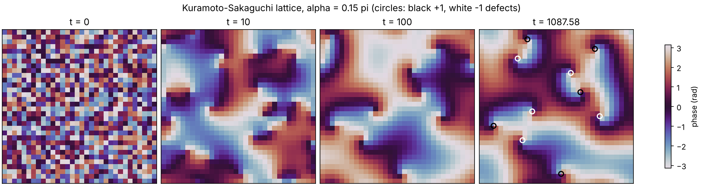

# Kuramoto–Sakaguchi lattice simulation

Python code accompanying the manuscript

> E. T. Günay, A. Ünlü, B. Altın, Ö. F. Dokumacı, Y. Gediz, A. C. Birkan, K. Güven and A. Kocabaş,
> *Self-Organized Travelling Waves and Emergent Mechanical Computation in Bacterial Active Matter* (submitted).

The script simulates the two-dimensional Kuramoto–Sakaguchi lattice of Eq. (1) of the paper,

```math
\frac{d\phi_i}{dt} = \omega_0 - K \sum_{j \in N(i)} \sin\left(\phi_i - \phi_j - \alpha\right),
```

where $N(i)$ are the four nearest neighbours of oscillator $i$, $\omega_0$ is the natural frequency shared by all oscillators, $K$ is the coupling strength and $\alpha$ is the phase lag. Starting from random phases, the lattice relaxes to a frequency-locked state. With the default parameters, this state contains spiral waves around topological defects.

## Contents

| File | Description |
|---|---|
| `kuramoto_sakaguchi_lattice.py` | Simulation of Eq. (1) |
| `example/kuramoto_lattice_example.png` | Figure produced by the demo below |
| `requirements.txt` | Python dependencies |

## System requirements

- Python 3 with NumPy and Matplotlib. No non-standard hardware is needed.
- Tested on Linux with Python 3.13, NumPy 2.5 and Matplotlib 3.11.

## Installation

From this folder:

```bash
pip install -r requirements.txt
```

Installation takes less than a minute on a typical computer.

## Demo

From this folder:

```bash
python kuramoto_sakaguchi_lattice.py
```

The demo uses the parameters given in the Methods: a 32 × 32 lattice with periodic boundaries, $K = 0.5$, $\omega_0 = 1$, $\alpha = 0.15\pi$, uniformly random initial phases (seed 42), explicit Euler steps of $\Delta t = 0.01$, and a locking tolerance of $10^{-5}$ on the spread of instantaneous frequencies. Expected output:

```
alpha = 0.15 pi, L = 32, K = 0.5, seed = 42
locked at t = 1087.58 (frequency spread 1.00e-05)
Omega = 1.8177
consistency check: omega0 + K sin(alpha) Cbar = 1.8177
defects: 5 with charge +1, 5 with charge -1
saved kuramoto_lattice.png
```

The run takes about 10 s. The lattice counts as locked when the spread of instantaneous frequencies falls below the tolerance; $\Omega$ is then the common frequency. The last-but-one line evaluates $\omega_0 + K \sin\alpha \, \bar{C}$ from the Methods, where $\bar{C}$ is the lattice average of $C_i = \sum_{j \in N(i)} \cos(\phi_i - \phi_j)$. On the periodic lattice this equals the mean instantaneous frequency at all times, locked or not, so it checks the implementation rather than locking. The saved figure shows the phase field at $t = 0$, 10 and 100 and in the locked state, with +1 defects circled in black and −1 defects in white:



Other platforms or library versions can give slightly different numbers, but the two frequencies printed always agree. If a run does not lock by `--tmax`, the script says so and prints the mean instantaneous frequency instead of $\Omega$.

## Instructions for use

| Option | Default | Meaning |
|---|---|---|
| `--alpha` | 0.15 | phase lag, in units of π |
| `--L` | 32 | lattice size (L × L) |
| `--K` | 0.5 | coupling strength |
| `--omega0` | 1.0 | natural frequency |
| `--dt` | 0.01 | Euler time step |
| `--tmax` | 5000 | maximum simulation time |
| `--tol` | 1e-5 | locking tolerance |
| `--seed` | 42 | random seed for the initial phases |
| `--out` | `kuramoto_lattice.png` | output figure |
| `--no-show` | off | save the figure without opening a window |

For example, `python kuramoto_sakaguchi_lattice.py --alpha 0.10` locks at $\Omega \approx 1.59$, and `--alpha 0` (reciprocal coupling) locks at $\Omega = 1$ with no defects for the default seed.

## Licence

MIT; see [`LICENSE`](../LICENSE) at the top of the repository.

## Citation

If you use this code, please cite the paper above (full reference to be added on publication).
